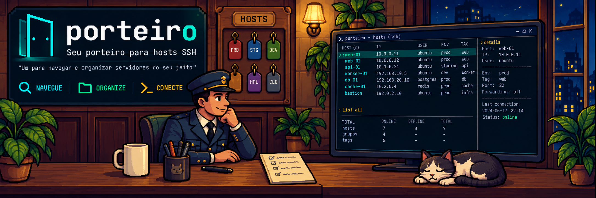

# Porteiro



[](https://github.com/jujubetsz/porteiro/actions/workflows/ci.yml)
[](LICENSE)

Porteiro is a keyboard-first terminal UI for browsing hosts declared in your
OpenSSH client configuration and connecting with the `ssh` already installed on
your machine.

It treats the SSH config as the source of truth. Porteiro does not store
credentials, implement the SSH protocol, probe hosts, or modify configuration
files.

```text
 porteiro  OpenSSH config hosts                                                               v0.2.0
╭ Hosts - 2 shown / 2 total ─────────────────────────────────╮╭ Details ───────────────────────────╮
│  Alias                  HostName                     Port  ││Alias        production             │
│› production             prod.example.test            2222  ││HostName     prod.example.test      │
│  staging                staging.example.test         22    ││User         deploy                 │
│                                                            ││Port         2222                   │
│                                                            ││ProxyJump    bastion                │
│                                                            ││ProxyCommand -                      │
│                                                            ││IdentityFile ~/.ssh/id_rsa          │
│                                                            ││             ~/.ssh/id_ecdsa        │
│                                                            ││             ~/.ssh/id_ecdsa_sk     │
│                                                            ││             ~/.ssh/id_ed25519      │
│                                                            ││             ~/.ssh/id_ed25519_sk   │
╰────────────────────────────────────────────────────────────╯╰────────────────────────────────────╯
 2 host(s) | ~/.ssh/config
 j/k move  / search  Enter connect  i details  r reload  v verbose  ? help  q quit
```

## Features

- Reads `~/.ssh/config` by default and follows `Include` directives in
  declaration order, including target-dependent include paths.
- Lists concrete `Host` aliases that can be passed to `ssh` literally, omitting
  wildcard, negated and otherwise invalid spellings.
- Organizes hosts into collapsible groups with optional tags and colors, using
  comments in the SSH config.
- Filters hosts with fuzzy search, including group names and tags.
- Shows effective HostName, User, Port, ProxyJump, ProxyCommand and
  IdentityFile values from `ssh -G`.
- Restores the terminal and launches `ssh` directly when you press `Enter`,
  optionally with `-v`, `-vv` or `-vvv`, then returns the SSH exit status to
  your shell.
- Adapts columns and the details pane to the available terminal width.

## Install

Porteiro needs an OpenSSH-compatible `ssh` executable on the machine it runs on.
For rounded tag badges, select a terminal font with the Powerline semicircle
glyphs (`U+E0B6` and `U+E0B4`), such as a [Nerd Font](https://www.nerdfonts.com/).
Porteiro cannot detect whether the terminal's font contains these glyphs.

**Release binaries.** Download the archive for your platform from the
[releases page](https://github.com/jujubetsz/porteiro/releases), verify the
`.sha256` file, and place `porteiro` on your `PATH`:

```sh
tar -xzf porteiro-<version>-<target>.tar.gz
install -m 0755 porteiro-<version>-<target>/porteiro ~/.local/bin/porteiro
```

**From source** with a stable Rust toolchain (1.88 or newer):

```sh
cargo install --git https://github.com/jujubetsz/porteiro --locked
```

**Nix**, without installing anything:

```sh
nix run github:jujubetsz/porteiro
```

## Usage

```text
porteiro [--config PATH] [--ssh PATH]
```

`--config` selects another user configuration file. The same path is passed to
OpenSSH with `-F` for details and connections. `--ssh` selects another
OpenSSH-compatible executable and is useful when `ssh` is not on `PATH`.

The running binary's version is always shown at the top right, including in
narrow terminals and while overlays are open. `porteiro --version` reports the
same package version without opening the TUI or reading your SSH config. Both
values are embedded from `Cargo.toml` when the binary is compiled.

| Key | Action |
| --- | --- |
| `j` / `k`, arrows | Move selection |
| `PgUp` / `PgDn`, `Home` / `End` | Move by page, jump to first or last row |
| `/` | Focus search |
| `Enter` | Accept search, expand/collapse a group, or connect to a host |
| `Space` | Expand/collapse the selected group |
| `Esc` | Clear search or close an overlay |
| `i` | Toggle the details overlay |
| `r` | Reload the config |
| `w` | View configuration warnings; `j`/`k` browse them, `Esc` closes |
| `v` | Cycle the verbosity of the next connection: `-v`, `-vv`, `-vvv`, off |
| `?` | Toggle help |
| `q` / `Ctrl-C` | Quit |

The selected host shows a badge with the pending flag, and the `Enter` hint
and status line repeat it, so you can debug a failing connection without
leaving the list.

Porteiro exits after the SSH session ends and returns the SSH process exit
status to the calling shell. On Unix, a session terminated by a signal returns
the conventional shell-visible status `128 + signal`.

## Groups, tags, colors and visibility

Add full-line `# porteiro:` comments to your SSH config or included files.
These are Porteiro annotations, not SSH options. OpenSSH
[ignores comment lines](https://man.openbsd.org/ssh_config#DESCRIPTION), so
the same files continue to work with `ssh`, `scp` and `sftp`.

```sshconfig
# Defaults for hosts declared in this file
# porteiro: group="Work" color=blue

Host production
    HostName prod.example.test
    User deploy
    # porteiro: tags=prod,api color=red

Host staging
    HostName staging.example.test
    # porteiro: tags=staging,api

Host personal
    HostName home.example.test
    # porteiro: group="Personal" tags=homelab color=green

Host standalone
    HostName standalone.example.test
    # porteiro: group="" color=default
```

```text
▸ Work (2)
▾ Personal (1)
└─ personal  homelab
standalone
```

- Each host has at most one group and any number of comma-separated tags.
  Quote names containing spaces. Group and tag names are case-sensitive;
  search is case-insensitive. Repeated tags are shown once, in written order.
- For nested groups, use `group_path="Production/APIs"`. Each `/` introduces
  another level; spaces around each name are trimmed and empty components are
  rejected. `group="Production/APIs"` remains a single literal group for
  compatibility. Use only one of `group` and `group_path` on the same annotation;
  either replaces the whole inherited path. `group_path=""` clears grouping.
- Annotations before the first `Host` or `Match` in a file set that file's
  defaults. Inside a `Host` block they override fields for the concrete aliases
  declared in that block. The last valid annotation for a field wins;
  omitted fields retain their values. Tags replace, rather than append to,
  inherited tags. Use `group=""`, `tags=""` or `color=default` to reset a field.
- Defaults and block annotations stay in their own file. They do not flow
  through `Include`, even when an included file contains only SSH options.
  The first reachable declaration retained for an alias supplies its metadata;
  later duplicate declarations do not overwrite it.
- Annotations in `Match` blocks or blocks with no concrete aliases are ignored
  with a warning. Annotations do not apply wildcard matching or evaluate
  `Match` criteria. Inline comments after SSH options remain ordinary comments.
- Colors are `red`, `yellow`, `green`, `blue`, `magenta`, `cyan`, `white`, `gray`
  or `default`. They accent host names. A group's header uses the
  color of its first retained host. Selection and labels remain visible without
  relying on color.
- Tags appear as rounded capsules in a separate `Tags` column, with a fixed
  neutral background and text color. Their colors stay the same across host
  accents and selection, and each host still occupies one terminal row.
- Add `# porteiro: hidden=true` inside a `Host` block to hide its aliases from
  Porteiro's list, search and groups. The SSH configuration and direct `ssh`
  connections remain unchanged. This field follows the same file-local defaults
  and declaration rules as other annotations; `hidden=false` overrides a hidden
  default. Hidden declarations still undergo configuration validation.
- Malformed annotations are ignored as a whole, with file and line diagnostics
  available through `w`. Unknown keys/colors, duplicate keys on one line and
  control/bidirectional formatting characters are rejected. Ordinary SSH
  syntax and Include errors retain their existing handling.

Groups start collapsed above ungrouped hosts. At each level, subgroups follow
their first appearance and precede directly assigned hosts, which retain
declaration order. Counts include all descendant hosts. Identically named
subgroups under different parents have independent expansion state. Search also
matches full group paths and tags, temporarily opens all ancestors of matching
hosts and ranks matching hosts within each group. Clearing the query restores
the previous expansion state, including subgroups.
Reload preserves surviving expanded groups and the selected row when it remains
visible; expansion is kept only for the current session.

For example:

```sshconfig
Host prod-api
    # porteiro: group_path="Production/APIs" tags=api color=red
Host prod-db
    # porteiro: group_path="Production/Databases"
Host bastion
    # porteiro: group="Production"
Host staging-api
    # porteiro: group_path="Staging/APIs"
Host legacy
    # porteiro: hidden=true
```

```text
Alias                   Tags
▾ Production (3)
├─ ▾ APIs (1)
│  └─ prod-api           api
├─ ▸ Databases (1)
└─ bastion
▸ Staging (1)
```

The `Tags` column stays aligned independently of alias length and tree depth.
It is omitted when no hosts have tags or the terminal is too narrow to keep
the alias and connection flag readable. Whole badges fit within the column;
a `+N` marker reports additional tags. Press `i` for the full group path and
tag values, including when the column is hidden. In a deeply nested tree,
distant ancestor connectors give way to host names and connection flags.

## How host discovery works

Values shown in the list are lightweight hints from the read-only catalog
validation. When no applicable `Port` option is set, the list shows
[OpenSSH's default port, 22](https://man.openbsd.org/ssh_config#Port). A port
that depends on an unknown `Match` outcome or Include path remains `-`.
The details view is authoritative: it asks OpenSSH for the selected alias's
effective configuration with `ssh -G` under a three-second timeout.

- OpenSSH evaluates user-authored `Match exec` directives while doing this, so
  commands intentionally present in the SSH config can run when a host is
  selected. Preview resolution disables hostname and CNAME canonicalization to
  avoid DNS traffic; the real connection uses the configuration unchanged.
- While building the catalog, command- and machine-state-dependent `Match`
  outcomes are treated as unknown, so they cannot introduce speculative aliases
  or execute local commands.
- Reachable recursive `Include` cycles are rejected, matching OpenSSH's
  eventual include-depth failure. On Unix, files reached through `Include`
  must satisfy OpenSSH's ownership and write-permission checks.
- Catalog validation models OpenSSH's requested final configuration pass:
  `Host` is matched against the effective normalized host while
  `originalhost` remains the selected alias. A pass requested by
  `CanonicalizeHostname` stays deterministic for literal IPs; hostnames whose
  canonical form may require DNS are treated as unknown. `CanonicalizeHostname
  yes` keeps a known proxied hostname unchanged because OpenSSH skips DNS in
  that case, and names with more dots than `CanonicalizeMaxDots` bypass
  canonicalization, matching OpenSSH's default and first-value semantics.
- Numeric addresses use the platform's DNS-free OpenSSH-compatible parser and
  canonical textual form, including legacy IPv4 spelling and scoped IPv6. Port
  values are normalized to decimal before `%p` and `%C` expansion.
- Aliases are the spellings OpenSSH accepts as a literal host argument:
  wildcard, negated, invalid, lowercase `ssh://` URI and `user@host` forms are
  omitted. OpenSSH treats the URI scheme case-sensitively, so a differently
  cased spelling remains a literal alias.
- Both spaced and unspaced `=` directive separators are accepted; a quoted
  leading `=` remains part of the value.

## Development

```sh
nix develop        # optional
cargo fmt --all --check
cargo clippy --all-targets --all-features -- -D warnings
cargo test --all-targets --all-features
cargo build --release --all-features
```

CI runs the same gate on Linux and macOS plus a Windows `cargo check`, a
minimum supported Rust version check and a dependency audit. After successful
checks on `main`, release-please maintains a release PR from conventional
commits, updating `Cargo.toml`, `Cargo.lock` and `CHANGELOG.md`.

Merging the release PR and passing CI creates the `vX.Y.Z` tag and GitHub
release. The same pipeline builds x86_64 Linux and Apple Silicon macOS
binaries from that tag and attaches the archives and SHA-256 checksums.
See the [release workflow](CONTRIBUTING.md#releases) for repository setup and
retrying a failed upload.

See [CONTRIBUTING.md](CONTRIBUTING.md) for the workflow and
[AGENTS.md](AGENTS.md) for the product contract, invariants and architecture.

## License

Licensed under the [Apache License, Version 2.0](LICENSE).
